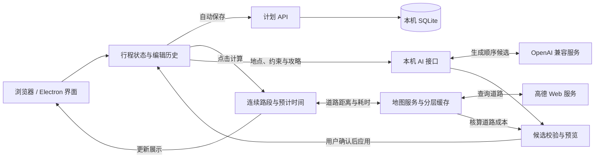

<p align="center">
  
</p>

<h1 align="center">TripMap</h1>

<p align="center"><strong>把想去的地方，连成一段旅程。</strong></p>
<p align="center">多日行程规划 · 高德地图 · AI 路线助手 · 本机保存</p>

<p align="center">
  <a href="https://github.com/YHonc/trip-map/releases/latest">下载应用</a> ·
  <a href="#快速上手">快速上手</a> ·
  <a href="#实现原理">实现原理</a> ·
  <a href="docs/development-guide.md">开发指南</a> ·
  <a href="CHANGELOG.md">更新记录</a>
</p>

TripMap 将地点清单、每日安排和地图路线放在同一个界面中。你可以收集想去的地方，拖动调整顺序，计算路程与预计时间，再把行程导出分享。

支持 **Windows 安装版、免安装便携版和本地网页版**。

## 功能特性

| 功能 | 说明 |
| --- | --- |
| **多日行程编排** | 按日期和路线组织地点，拖拽排序，设置出发与停留时间，支持多计划和撤销重做 |
| **地图搜索与收藏** | 搜索高德地点、单击地标查看详情、双击地图选点；收藏地点或一键收藏当天行程 |
| **道路与时间计算** | 选择驾车、步行、骑行或地铁，计算距离、交通耗时和预计到达、离开时间 |
| **AI 路线助手** | 按时间、距离或自定义要求优化顺序，结合旅行偏好与攻略参考，比较后应用 |
| **攻略导入与分享** | 导入精简 JSON、用 AI 整理文字攻略、批量匹配地点，导出 JSON 或含底图的 PNG / SVG |
| **地图批注与本机保存** | 画线、圈选和擦除；自动保存计划、记住地图视角，复用查询缓存并查看 API 用量 |

## 快速上手

### 1. 下载并打开

从 [GitHub Releases](https://github.com/YHonc/trip-map/releases/latest) 下载适合的版本，运行时已随包提供。

| 版本 | 文件 | 使用方式 |
| --- | --- | --- |
| 安装版 | `TripMap-Setup-*-x64.exe` | 安装后从桌面快捷方式打开 |
| 便携版 | `TripMap-Portable-*-x64.exe` | 双击运行 |
| 网页版 | `TripMap-Web-*-x64.zip` | 解压并运行 `Start-Web.cmd`，访问 `http://127.0.0.1:32145` |

### 2. 配置地图

首次打开可直接体验演示模式。使用高德地图时，在「地图设置」中选择高德，填写 **JS API Key、对应的安全密钥和 Web 服务 Key**，保存后即可搜索地点和计算道路路线。

密钥申请见 [高德 JS API 文档](https://lbs.amap.com/api/jsapi-v2/guide/abc/load)与 [Web 服务文档](https://lbs.amap.com/api/webservice/summary)。

### 3. 安排一次旅行

1. **收集地点**：新建计划、设置城市，通过搜索、地图选点或导入攻略添加地点。
2. **编排行程**：拖动调整顺序，选择交通方式，设置每天出发时间和各站停留时长。
3. **计算与分享**：点击「计算行程」查看道路和预计时间，完成后导出 JSON、PNG 或 SVG。

<details>
<summary><strong>启用 AI 路线助手（可选）</strong></summary>

在「AI 路线助手 → AI 配置」中填写 OpenAI 兼容接口地址、模型和 API Key。

- 在「自定义提示词」中保存常用旅行偏好。
- 选择时间、距离或自定义优化目标，并设置固定起终点、地点先后关系。
- 为当前计划添加文字或 TXT 攻略，勾选需要参考的资料。
- 生成建议，比较调整前后的路线和道路成本，再选择应用。

</details>

计划与攻略默认保存在 `%LOCALAPPDATA%\TripMap`，地图视角和批注保存在当前浏览器。升级与换机操作见 [使用说明](桌面版使用说明.md)。

## 实现原理

网页与桌面共用一套 **React 界面、Next.js 本机服务和 SQLite 数据模型**。Electron 提供桌面窗口，独立 Node 进程承载本机服务。

1. **行程编辑**：用「计划 → 日期 → 路线 → 地点到访」组织数据，侧栏和地图共享状态，编辑历史支持撤销与重做。
2. **本机存储**：通过计划 API 自动保存到 SQLite，使用修订号和事务协调多窗口编辑。
3. **路线计算**：按当天可见地点连接路段，复用缓存或请求高德道路数据，再结合出发时间、交通耗时和停留时长生成时间线。
4. **AI 优化**：模型根据地点、约束和攻略生成排序候选，应用校验候选并核算道路成本，用户预览后确认。
5. **地图与导出**：高德 JS SDK 展示交互地图；导出模块将行程生成 JSON，或与静态底图组合为 PNG / SVG。



源码入口：[行程状态](src/hooks/use-planner.tsx) · [路线与时间计算](src/hooks/use-itinerary-calculation.ts) · [AI 候选处理](src/lib/optimization.ts)。

## 本地开发

准备 **Node.js 22 LTS（22.12+）** 和 npm：

```bash
git clone https://github.com/YHonc/trip-map.git
cd trip-map
npm ci
npm run dev
```

访问 `http://127.0.0.1:3000`。Windows 也可运行 `Start-TripMap-Dev.cmd`；桌面启动入口为 `Start-TripMap.cmd`。

```bash
npm run typecheck       # 类型检查
npm test                # 单元与集成测试
npm run build           # 网页生产构建
npm run desktop:build   # Windows 桌面打包
```

技术栈：**Next.js 16 · React 19 · TypeScript · Tailwind CSS 4 · Electron · SQLite**。

## 项目文档

| 文档 | 阅读内容 |
| --- | --- |
| [使用说明](桌面版使用说明.md) | 启动、升级、备份与迁移 |
| [总体开发指南](docs/development-guide.md) · [目录结构](文件夹架构说明.md) | 架构、数据模型、调用链与源码导航 |
| [技术与维护说明](docs/technical-guide.md) | 配置、存储、缓存、构建与发布 |
| [行程格式](docs/itinerary-format.md) · [行程计算](docs/itinerary-calculation.md) | 导入示例、字段说明与时间计算 |
| [地图批注](docs/map-annotations.md) · [地铁、优化与收藏](docs/route-options-and-favorites.md) | 功能用法与实现细节 |

## 参与贡献

欢迎通过 [Issues](https://github.com/YHonc/trip-map/issues) 反馈问题或提出功能建议，也欢迎提交 Pull Request。问题反馈请附复现步骤；代码改动请说明用途和相关测试结果。

## 开源许可

采用 [MIT License](LICENSE)。第三方组件与服务说明见 [THIRD_PARTY_NOTICES](THIRD_PARTY_NOTICES.md)。
