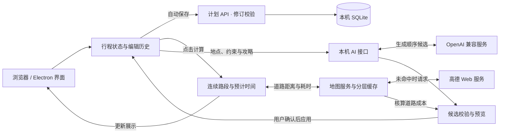

<div align="center">

# TripMap

**把想去的地方，连成一段旅程。**

在地图上安排多日旅行：收集地点、调整顺序、计算路程，再把行程带走。

[下载使用](https://github.com/YHonc/trip-map/releases/latest) · [开发指南](docs/development-guide.md) · [反馈问题](https://github.com/YHonc/trip-map/issues)

</div>

## 一张地图，安排整段旅行

TripMap 是一款本地旅行规划应用。左侧按天整理地点与时间，右侧在地图上查看位置和道路；调整行程后，点击「计算行程」即可查看距离、交通耗时和预计到达时间。

提供 **Windows 安装版、免安装便携版和本地网页版**。计划自动保存，下次打开继续编辑。

| 想做什么 | TripMap 可以帮你 |
| --- | --- |
| 收集想去的地方 | 搜索高德地点、单击地标查看详情、双击地图选点，先收藏再安排行程 |
| 整理多日旅行 | 按日期和路线分组，拖动地点调整顺序，管理多个旅行计划，支持撤销与重做 |
| 看清每天的安排 | 连续的地点时间线，设置出发时间和停留时长，统一计算预计到达与离开时间 |
| 比较交通方式 | 驾车、步行、骑行或地铁，查看相邻地点的距离与耗时 |
| 让 AI 提供建议 | 按时间、距离或自定义要求优化顺序，指定起终点、保留先后关系，预览后应用 |
| 利用已有攻略 | 导入精简 JSON、整理文字攻略、批量匹配地点，建立各计划独立的 TXT 攻略参考库 |
| 在地图上记想法 | 画线、圈选、换色、擦除和撤回，批注按计划保存在当前浏览器 |
| 保存与分享 | 导出行程 JSON，或生成含地图底图的 PNG / SVG；复用地图缓存并查看本机 API 用量 |

## 开始使用

### 下载成品

前往 [Releases](https://github.com/YHonc/trip-map/releases/latest)，选择适合的版本。所有下载包均内置运行时，无需安装 Node.js。

| 下载文件 | 启动方式 |
| --- | --- |
| `TripMap-Setup-*-x64.exe` | 安装后从桌面快捷方式打开 |
| `TripMap-Portable-*-x64.exe` | 双击运行，免安装 |
| `TripMap-Web-*-x64.zip` | 解压，运行 `Start-Web.cmd`，访问 `http://127.0.0.1:32145` |

桌面版也可通过「文件 → 在浏览器中打开」访问同一个计划库。版本变化见 [更新记录](CHANGELOG.md)，启动、升级与迁移见 [桌面版使用说明](桌面版使用说明.md)。

### 配置地图与 AI

首次打开即可体验无需密钥的 Mock 演示。使用真实地图时，在「地图设置」中选择高德并保存以下配置：

| 配置 | 用途 |
| --- | --- |
| 高德 JS API Key | 加载交互底图 |
| 对应的安全密钥 | 配合本机代理使用 JS API |
| 高德 Web 服务 Key | 搜索、地点详情、道路计算与图片导出 |

申请方式见 [高德 JS API 文档](https://lbs.amap.com/api/jsapi-v2/guide/abc/load)与 [Web 服务文档](https://lbs.amap.com/api/webservice/summary)。

使用 AI 功能时，在「AI 路线助手 → AI 配置」中填写 OpenAI 兼容接口地址、模型和 API Key。常用旅行偏好可保存到「自定义提示词」，本次要求可在自定义优化目标中单独填写。

## 从地点清单到完整行程

**1. 收集地点。** 新建旅行计划，按天设置城市。通过搜索或地图选点加入地点，也可先放入收藏篮，或直接导入已有 JSON、文字攻略。

**2. 调整与计算。** 拖动地点排列顺序，选择交通方式，设置当天出发时间和各站停留时长。点击「计算行程」，查看道路、距离和预计时间。同一天的可见地点按顺序连接，隐藏或空分组会被跳过。

**3. 比较与分享。** 让 AI 生成另一种顺序，结合道路成本预览决定是否应用。完成后导出 JSON 备份，或分享 PNG / SVG 规划图。导入规则和示例见 [行程格式说明](docs/itinerary-format.md)。

计划、攻略和连接配置保存在本机，默认目录为 `%LOCALAPPDATA%\TripMap`；地图视角和批注等浏览偏好保存在当前浏览器。换电脑时按 [备份与迁移说明](桌面版使用说明.md#数据与缓存)操作。

## 实现原理

TripMap 采用 **React 编辑界面 + Next.js 本机服务 + SQLite 存储**。浏览器与桌面版使用同一套业务逻辑；Electron 负责窗口和进程管理，独立 Node 进程运行本机服务。

1. **统一行程状态。** 将旅行组织为「计划 → 日期 → 路线 → 地点到访」，侧栏和地图读取同一份状态；拖拽、编辑和撤销重做都围绕这份数据更新。
2. **自动保存到本机。** 编辑后通过计划 API 保存到 SQLite，服务端校验修订号并在事务中更新，避免多个窗口互相覆盖；地图视角、选择状态和批注另存于浏览器。
3. **按需计算道路与时间。** 点击「计算行程」后，按当天可见地点派生连续路段，优先复用有效缓存，再请求高德道路数据。结合出发时间和停留时长推算到达、离开时间；计算期间行程发生变化时，不应用旧结果。
4. **AI 提建议，程序做核验。** 将地点、排序约束和选中的攻略片段交给配置的模型，校验候选是否保留地点及起终点规则，再核算前后道路成本。用户预览确认后应用；期间编辑过的行程需重新生成建议。
5. **从同一份行程生成分享内容。** JSON 导出保留行程结构；PNG / SVG 导出将路线、地点与高德静态底图组合，生成可直接查看的规划图。交互底图由浏览器中的高德 JS SDK 加载。



核心入口为 [行程状态管理](src/hooks/use-planner.tsx)、[行程计算](src/hooks/use-itinerary-calculation.ts)和 [AI 候选校验](src/lib/optimization.ts)。模块职责、数据契约与验证方式见 [总体开发指南](docs/development-guide.md)。

## 从源码开发

准备 **Node.js 22 LTS（22.12+）** 和 npm：

```bash
git clone https://github.com/YHonc/trip-map.git
cd trip-map
npm ci
npm run dev
```

访问 `http://127.0.0.1:3000`。Windows 也可运行 `Start-TripMap-Dev.cmd`；桌面启动入口为 `Start-TripMap.cmd`。

```bash
npm run typecheck       # 类型检查
npm test                # 隔离环境下的单元与集成测试
npm run build           # 网页生产构建
npm run desktop:build   # Windows 桌面打包
```

项目采用 **Next.js 16 · React 19 · TypeScript · Tailwind CSS 4 · Electron · SQLite**。网页和桌面共用本机服务及数据模型。

| 文档 | 阅读内容 |
| --- | --- |
| [总体开发指南](docs/development-guide.md) | 架构、数据契约、调用链、功能修改入口和验证范围 |
| [文件夹架构说明](文件夹架构说明.md) | 目录职责、启动器和源码入口 |
| [技术与维护说明](docs/technical-guide.md) | 配置、存储、缓存、构建和发布 |
| [行程计算](docs/itinerary-calculation.md) | 连续行程、预计时间与缓存复用 |
| [地图批注](docs/map-annotations.md) | 操作手势与保存方式 |
| [地铁、优化与收藏](docs/route-options-and-favorites.md) | 交通方案、AI 约束及收藏行为 |

## 许可与贡献

TripMap 采用 [MIT License](LICENSE)。第三方组件和地图服务说明见 [THIRD_PARTY_NOTICES](THIRD_PARTY_NOTICES.md)。欢迎提交 [Issue](https://github.com/YHonc/trip-map/issues) 或 Pull Request。
